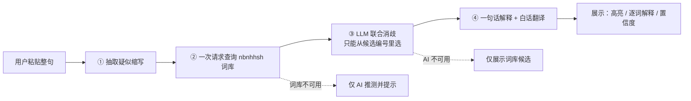

# 🔎 圈层黑话解释器

> 粘贴一段含缩写的评论，结合**整句上下文**读懂 `yyds`、`jd`、`u1s1` 这类圈层黑话在这句话里到底指什么。

**在线体验：** 【待补：部署后的链接】　|　**项目类型：** 个人项目（产品设计 + LLM 应用）

---

## 演示

> 📸 **【待补：演示 GIF】** 录一段 10 秒左右的操作：粘贴句子 → 点"解释" → 看到高亮、白话翻译、逐词解释 → 展开"其他可能含义"。
>
> 放到 `docs/images/demo.gif`，然后把下面这行取消注释：

<!--  -->

---

## 为什么做这个

豆瓣、微博、B 站、饭圈、体育论坛的评论里，大量使用英文或数字缩写：`yyds`、`jd`、`u1s1` ……
对误入圈子的路人、刚入坑的新人、家长来说，看不懂，去问朋友或搜索又很麻烦。

[nbnhhsh（能不能好好说话）](https://github.com/itorr/nbnhhsh) 能查出一个缩写的**所有可能含义**，但有两个不方便的地方：

1. 同一个缩写往往有十几个候选（例如 `gps` 可能是"导航系统"，也可能是"国乒丝"），需要用户**自己判断**哪个对；
2. 只给含义，没有"这句话整体什么意思"，也没有解释。

这个项目做的就是补上这一层：**用 LLM 结合整句上下文，在词库候选里选出最可能的含义，并给出整句白话翻译。**

## 功能

- **整句粘贴**：自动识别句子里的疑似缩写，并在原句中高亮
- **白话翻译**：把整句改写成通俗的话
- **逐词解释**：每个缩写给出最可能的含义、一句话解释和置信度，其他可能含义可折叠查看
- **多缩写联合判断**：一句话里有多个缩写时一起判断
- **没把握就说没把握**：词库没收录或判断不确定时，明确标注"AI 推测，仅供参考"，不硬选
- **补充背景重新解释**：第一次判断不准时，补一句背景（如"这是在说娱乐圈"）让 AI 重新判断
- **用户反馈**：👍 / 👎 和纠错说明

## 和"直接问通用 AI"有什么区别

| | 直接问通用 AI | 本产品 |
|---|---|---|
| 含义来源 | 模型自己的知识，新缩写和圈内梗可能不认识，容易编造 | 来自众包词库的候选，AI **只能按编号从候选里选** |
| 没把握时 | 倾向给出一个听起来合理的答案 | 返回"不确定"并展示候选，或标注"AI 推测" |
| 多个缩写 | 需要用户逐个追问 | 一次请求、整句联合判断 |
| 使用成本 | 需要自己组织提问 | 粘贴即用，原句高亮对照 |

> 📸 **【待补：对比截图 1】** 同一句话：通用 AI 的回答 vs 本产品的结果
> `docs/images/compare-1.png`
>
> 📸 **【待补：对比截图 2】** 多个缩写的例子
> `docs/images/compare-2.png`
>
> 📸 **【待补：对比截图 3】** 没把握 / 词库未收录时的兜底提示
> `docs/images/compare-3.png`

**对比记录（请如实填写，包括通用 AI 答对的情况）：**

| 句子 | 通用 AI 的回答 | 本产品的结果 | 备注 |
|---|---|---|---|
| 【待补】 | 【待补】 | 【待补】 | 【待补】 |
| 【待补】 | 【待补】 | 【待补】 | 【待补】 |
| 【待补】 | 【待补】 | 【待补】 | 【待补】 |

## 工作原理



1. **抽取**：按"2 位以上字母数字"的规则抽取缩写（与 nbnhhsh 官方脚本一致）。先剔除链接和邮箱；长数字串（可能是年份、电话、订单号）不查询、也不发给第三方。
2. **查词库**：同一句话里的所有缩写，用一次请求查询；结果缓存 7 天，减少对第三方接口的请求。
3. **联合消歧**：把整句、补充背景、所有缩写及其候选放进**同一个 prompt**，让模型先判断语境，再逐词选择，输出固定格式的 JSON。
4. **生成解释**：一句话解释这个含义在本句里指什么，并把整句改写成白话。

## 设计取舍与降级策略

| 情况 | 系统怎么处理 |
|---|---|
| AI 选的编号不在候选范围内 | 不采信，标为"不确定"，展示词库候选 |
| 词库完全没有这个缩写 | 仅此时允许显示 AI 的推测，并标注"词库未收录，AI 推测，仅供参考" |
| 词库只有"输入联想"，没有正式收录 | 置信度封顶为"低"，并提示可靠性低 |
| 这个词其实不是黑话（如品牌名） | 标记为"不是黑话"并忽略 |
| 词库接口不可用 | 全部由 AI 推测，并给出明确提示 |
| AI 服务不可用 / 输出格式错误 | 自动重试一次；仍失败则只展示词库候选，不做选择 |
| 一句话缩写过多 / 句子过长 | 最多处理 12 个缩写、500 字 |

**为什么让 AI 只能选编号，而不是自由回答？** 这样 AI 的选择范围被限定在词库给出的候选内，既减少编造，也让"选对了没有"可以被检查。置信度（高 / 中 / 低）是模型自评的结果，**没有经过校准，只作参考**。

## 效果

> ⚠️ 下面的数字请在自测和试用结束后**如实填写**，样本小就写样本小；没有测的就不要填。

**自测**

| 指标 | 结果 |
|---|---|
| 测试句子数 | 【待补：N 句，覆盖单缩写歧义 / 多缩写 / 数字类 / 词库未收录 / 非黑话】 |
| 含义选对的比例 | 【待补：X / N】 |
| 高置信度但选错的数量 | 【待补：Y】 |
| 典型失败原因 | 【待补：如词库缺少正确含义、语境信息不足等】 |

**真人试用**

| 指标 | 结果 |
|---|---|
| 试用人数 / 使用次数 | 【待补】 |
| 👍 比例 | 【待补】 |
| "补充背景重新解释"的使用比例 | 【待补】 |
| 词库未收录的高频词 | 【待补】 |

## 本地运行

```bash
git clone https://github.com/【你的用户名】/【仓库名】.git
cd 【仓库名】
python -m venv venv
# Windows: venv\Scripts\activate    macOS/Linux: source venv/bin/activate
pip install -r requirements.txt
cp .env.example .env      # 然后在 .env 里填入你的 LLM 配置
streamlit run app.py
```

也可以只测试核心流程：

```bash
python slang_core.py "不晓得这次32发挥如何，你们gp梯队建设太糟糕了" #打算删
python test_core.py       # 离线测试，不访问词库接口，也不调用 LLM
```

**配置项（`.env`）**

| 变量 | 说明 |
|---|---|
| `ANTHROPIC_API_KEY` | LLM 服务的 Key |
| `ANTHROPIC_BASE_URL` | 接口地址（使用兼容 Anthropic 接口的服务时填写） |
| `ANTHROPIC_MODEL` | 模型名 |
| `LLM_DISABLE_THINKING` | 默认 `1`，关闭模型思考，避免输出被思考过程占满 |
| `SLANG_DEBUG` | 设为 `1` 时在页面显示 AI 失败的真实原因，仅用于排查 |

没有配置 LLM 时，页面仍可使用，但只展示词库候选，不做选择。

## 项目结构

```
├── app.py               # Streamlit 页面
├── slang_core.py        # 核心流水线：抽取 → 词库 → 联合消歧 → 结果
├── test_core.py         # 离线测试
├── requirements.txt
├── .env.example
└── .streamlit/secrets.toml.example   # 部署到 Streamlit Cloud 时的 Secrets 示例
```

## 隐私与数据

- 你输入的**整句**会发送给所配置的 LLM 服务，用于判断含义。
- 只有从句子里抽取出的**缩写**会发送给 nbnhhsh 词库接口，原句不会发给词库。
- 反馈只保存缩写、选择的含义、点赞 / 点踩和你填写的纠错说明，**不保存原句**。
- 请不要在这个工具里粘贴含有个人隐私的内容。

## 局限

- 含义来自众包词库：词库没有收录的缩写，或者正确含义不在候选里，系统无法选对，只能提示不确定。
- 一句话的解释由 AI 生成，对冷门词和新词可能出错，所以页面上标注了"仅供参考"。
- 目前只识别由字母和数字组成的缩写，不处理纯中文的谐音梗、网络用语。
- 自测句子由本人编写，规模有限，不能代表真实评论的整体分布。
- 置信度是模型自评，没有校准。

## 致谢

- 词库与接口来自开源项目 [itorr/nbnhhsh](https://github.com/itorr/nbnhhsh)。本项目是基于该词库的个人学习项目，与原项目没有官方关联。本项目负责的是上下文消歧、降级策略、产品交互与部署。
- 使用词库接口时请遵守其项目的许可与使用说明，并避免高频请求。

## 许可

【待补：请先查看 nbnhhsh 仓库的 LICENSE，再决定本项目采用的许可协议】

## 后续计划（尚未实现）

- 浏览器划词插件
- 基于用户反馈补充词库未收录的缩写
- 对冷门词接入百科检索，降低 AI 解释出错的概率